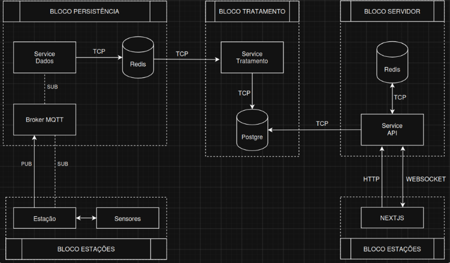

  # AgriTech - API DSM 4º Semestre 2026

  <h2 align="center">Vulture API</h2>

  <p align="center">
  Solução IoT para monitoramento meteorológico desenvolvida pela Equipe Vulture.
  </p>

  > **Status do Projeto:** Sprint 1 em andamento  
  > **Jira:** https://vultureapi.atlassian.net/jira/software/projects/SCRUM/boards/1/backlog  
  > **Confluence:** https://vultureapi.atlassian.net/wiki/x/AYA7

  ---

  ## 😢 Dor do Cliente

  A principal dor está no desejo de coletar, processar e disponibilizar, de forma confiável e quase em tempo real, os grandes volumes de dados climáticos gerados por uma quantidade crescente de sensores distribuídos em áreas agrícolas extensas, mantendo a disponibilidade e a precisão das informações, afim de expandir seu portfólio.

  ## 🏅 Desafio

  Desenvolver uma solução de estação meteorológica capaz de coletar, processar, armazenar e disponibilizar dados climáticos de forma confiável e quase em tempo real, garantindo escalabilidade, disponibilidade, integridade dos dados e monitoramento dos sensores, mesmo com o crescimento da quantidade de dispositivos e das áreas agrícolas atendidas.

  ## 💡 Solução

  Desenvolver uma solução integrada de monitoramento meteorológico composta por uma estação
  meteorológica de baixo custo, um datalogger e uma plataforma web.

  A estação meteorológica será responsável pela coleta periódica de dados por meio de sensores, como temperatura, umidade, precipitação e outras variáveis definidas para o projeto. Essas medições serão realizadas em intervalos previamente configurados.

  ---

  # 📋 Backlog do Produto

O Product Backlog é mantido e refinado continuamente no Jira e no Confluence.

| ID | Prioridade | User Story | Planning Poker |
|---:|:---:|---|---:|
| 1 | Alta | Como Administrador, quero cadastrar e gerenciar estações meteorológicas, para controlar as estações instaladas. | 8 |
| 2 | Alta | Como Administrador, quero cadastrar sensores e parâmetros, para permitir diferentes tipos de medições. | 8 |
| 3 | Alta | Como Administrador, quero cadastrar e gerenciar usuários, para incluí-los no Sistema. | 8 |
| 4 | Alta | Como Gerente Agrícola, quero visualizar o status das estações, para identificar problemas de comunicação. | 5 |
| 5 | Alta | Como Gerente Agrícola, quero cadastrar e configurar alertas meteorológicos, para ser avisado sobre condições críticas. | 5 |
| 6 | Alta | Como Cliente, quero contar com a disponibilidade e escalabilidade do sistema, para suportar o crescimento das estações e atender ao SLA definido. | 13 |
| 7 | Alta | Como Gerente Agrícola, quero visualizar os dados meteorológicos atuais, para acompanhar as condições climáticas. | 8 |
| 8 | Alta | Como Gerente Agrícola, quero visualizar o histórico dos dados, para analisar períodos anteriores. | 8 |
| 9 | Média | Como Administrador, quero identificar estações ou sensores com falhas ou dados inconsistentes, para facilitar a manutenção. | 13 |
| 10 | Média | Como Administrador, quero gerenciar o acesso de usuários cadastrados no Sistema, para controlar os níveis de acesso. | 8 |
| 11 | Média | Como Gerente Agrícola, quero visualizar estatísticas dos dados, para analisar o comportamento do clima e visualizar previsões futuras. | 13 |
| 12 | Média | Como Gerente Agrícola, quero receber os dados tratados das estações, para centralizar as informações. | 8 |
| 13 | Alta | Como Gerente Agrícola, quero cadastrar e gerenciar propriedades agrícolas, para associá-las às estações meteorológicas e organizar o monitoramento climático de cada propriedade. | 8 |
| 16 | Baixa | Como Cliente, quero que o sistema possua um pipeline de CI, para automação de testes e validações de código. | 13 |

  # 🏗️ Arquitetura do Projeto

A arquitetura do Agritech evoluiu ao longo do desenvolvimento conforme as necessidades de integração, manutenção e escalabilidade da solução foram sendo validadas.

A arquitetura atual utiliza uma abordagem de **monólito modular no backend**, mantendo os domínios organizados e com responsabilidades separadas, além de serviços específicos para o fluxo de ingestão dos dados meteorológicos.

Principais componentes da solução:

- **Frontend:** Next.js, responsável pelas interfaces de gerenciamento e visualização dos dados.
- **Backend:** Node.js com Fastify, estruturado como monólito modular e organizado em camadas.
- **Ingestão de dados:** serviços em Python responsáveis pelo recebimento e processamento das medições.
- **Comunicação IoT:** MQTT para envio das informações provenientes das estações meteorológicas.
- **Redis:** utilizado como armazenamento intermediário e apoio ao processamento dos dados.
- **PostgreSQL:** banco de dados persistente utilizado para armazenamento das informações tratadas.
- **API:** responsável pela comunicação entre frontend, backend e demais componentes da solução.
- **Monitoramento e CI:** estrutura em evolução para acompanhamento da disponibilidade, desempenho, testes e qualidade do código.



---


 # 🗓️ Sprints

  | Sprint | Período | Documentação da Sprint | Vídeo do Incremento |
  | :---: | --- | --- | --- |
  | Sprint 1 | 07/09/2026 a 27/09/2026 | [Documentação](docs/Sprint1) | A adicionar |
  | Sprint 2 | 05/10/2026 a 25/10/2026 | A adicionar | A adicionar |
  | Sprint 3 | A definir | A adicionar | A adicionar |

  ---

  ## 💻 Tecnologias <a id="tecnologias"></a>

<h4 align="center">

  <a href="https://developer.mozilla.org/pt-BR/docs/Web/HTML">
    
  </a>

  <a href="https://developer.mozilla.org/pt-BR/docs/Web/CSS">
    
  </a>

  <a href="https://developer.mozilla.org/pt-BR/docs/Web/JavaScript">
    
  </a>

  <a href="https://nodejs.org/">
    
  </a>

  <a href="https://react.dev/">
    
  </a>

  <a href="https://nextjs.org/">
    
  </a>

  <a href="https://www.typescriptlang.org/">
    
  </a>

  <a href="https://www.python.org/">
    
  </a>

  <a href="https://isocpp.org/">
    
  </a>

  <a href="https://www.c-language.org/">
    
  </a>

  <a href="https://www.arduino.cc/">
    
  </a>

  <a href="https://tailwindcss.com/">
    
  </a>

  <a href="https://www.postgresql.org/">
    
  </a>

  <a href="https://mosquitto.org/">
    
  </a>

  <a href="https://redis.io/">
    
  </a>

  <a href="https://www.docker.com/">
    
  </a>

</h4>

  ---

  

  # ▶️ Como Executar, Usar e Testar

  > Esta seção será atualizada conforme os serviços executáveis forem disponibilizados.

  ## Pré-requisitos

  - A definir.

  ## Clonar o repositório

  ```bash
  git clone https://github.com/Vulture-API/API-DSM-4SEMESTRE-2026.git
  cd API-DSM-4SEMESTRE-2026
  ```

  ## Instalar dependências

  ```bash
  npm install
  ```

  ## Ambiente

  ```text
  .env
  ```

  ## Execução e testes

  Os comandos específicos serão documentados em cada serviço à medida que forem disponibilizados.

  ---

  # 📚 Documentação

  - 📁 [Pasta de documentação](docs/)
  - 🔗 [Confluence](https://vultureapi.atlassian.net/wiki/x/AYA7)

  ## ✅ Checklist de DoR e DoD

  ### Definition of Ready — DoR

  Uma User Story ou Task estará pronta quando:

  - [ ] objetivo estiver claro;
  - [ ] estiver alinhada à Dor do Cliente;
  - [ ] critérios de aceite estiverem definidos;
  - [ ] regras de negócio principais estiverem documentadas;
  - [ ] dependências forem conhecidas;
  - [ ] impedimentos críticos tiverem tratamento;
  - [ ] puder ser estimada;
  - [ ] tiver sido refinada com os Developers;
  - [ ] prioridade e Sprint estiverem definidas;
  - [ ] puder ser decomposta em Tasks executáveis.

  ### Definition of Done — DoD

  Uma User Story ou Task estará concluída quando:

  - [ ] implementação estiver concluída;
  - [ ] critérios de aceite forem atendidos;
  - [ ] código estiver na branch correta;
  - [ ] commits seguirem o padrão;
  - [ ] PR estiver aberta para `dev`;
  - [ ] houver Code Review por outro Developer;
  - [ ] ajustes obrigatórios estiverem resolvidos;
  - [ ] testes pertinentes forem executados;
  - [ ] documentação necessária estiver atualizada;
  - [ ] não houver segredos versionados;
  - [ ] PR estiver aprovada e integrada à `dev`;
  - [ ] rastreabilidade Jira ↔ branch ↔ commit ↔ PR estiver preservada;
  - [ ] item estiver disponível para demonstração;
  - [ ] item estiver **Concluído** no Jira.

  > Os registros de DoR e DoD específicos de cada Sprint deverão ser mantidos na documentação da respectiva Sprint.

  ---

  ## 🌿 Estratégia de Branch

  A Equipe Vulture utiliza uma estratégia com `main` como versão estável e `dev` como branch de integração.

  ```text
  feature/docs/fix/test/chore
            ↓
          dev
            ↓
    integração e testes
            ↓
          main
  ```

  ### Regras

  - `main` representa a versão estável;
  - `dev` é a branch de integração;
  - branches de trabalho devem partir da `dev`;
  - não desenvolver diretamente em `main` ou `dev`;
  - toda integração ocorre por Pull Request;
  - PRs passam por Code Review;
  - sempre que possível, o autor não aprova o próprio PR.

  ### Exemplos

  ```text
  feature/SCRUM-123-cadastro-estacao
  fix/SCRUM-145-validacao-estacao
  docs/SCRUM-266-regras-estacoes
  test/SCRUM-205-testes-usuarios
  chore/configura-pipeline
  ```

  ---

  ## 📝 Padrão de Mensagens dos Commits

  Formato adotado conforme o guia da disciplina:

  ```text
  <tipo> (<id_demanda1>, <id_demanda2>, ..., <id_demandaN>): <descrição da entrega>
  ```

  | Tipo | Uso |
  | --- | --- |
  | `feat` | Nova funcionalidade |
  | `fix` | Correção de bug |
  | `docs` | Documentação |
  | `style` | Formatação sem impacto funcional |
  | `refactor` | Refatoração |
  | `test` | Testes |
  | `chore` | Configuração ou manutenção |

  Exemplos:

  ```text
  feat (SCRUM-101): implementa cadastro de estações
  docs (SCRUM-266): documenta regras de gerenciamento de estações
  fix (SCRUM-145): corrige validação do código da estação
  test (SCRUM-205): adiciona testes do cadastro de usuários
  ```

  ### Boas práticas de Git

  - utilizar `.gitignore`;
  - nunca realizar commit direto na `main`;
  - referenciar a demanda nos commits;
  - realizar commits pequenos e objetivos;
  - descrever a entrega com clareza;
  - utilizar Pull Requests;
  - descrever implementação e testes na PR;
  - aguardar Code Review antes do merge;
  - sempre que possível, não aprovar o próprio PR.

  ---

  ## 📘 Manual do Usuário

  Será produzido conforme as funcionalidades forem concluídas.

  ## 📖 Manual de Instalação

  Será atualizado conforme os serviços e dependências finais forem consolidados.

  ---

# 👥 Equipe <a id="equipe"></a>

| Integrante | Papel no DEV Team | Função no DevOps | GitHub | LinkedIn |
| :--- | :---: | :--- | :---: | :---: |
| **Aline Raquel Camargo de Oliveira** | Scrum Master | Rastreabilidade | <a href="https://github.com/AlineRaquelC"></a> | <a href="https://www.linkedin.com/in/aline-oliveira-60ab6265/"></a> |
| **Ana Júlia Rubim** | Product Owner | Documentação | <a href="https://github.com/anajrubim"></a> | <a href="https://www.linkedin.com/in/ana-j%C3%BAlia-rubim/"></a> |
| **Lucas Marins Santos** | Developer | CI/CD / Pipeline / GitHub Actions | <a href="https://github.com/lucasMarinsSantos"></a> | <a href="https://www.linkedin.com/in/lucasmarinssantos/"></a> |
| **Enrico de Chiara Germano** | Developer | Deploy / Ambientes | <a href="https://github.com/EnricoGermano"></a> | <a href="https://www.linkedin.com/in/enrico-de-chiara-germano-022894204/"></a> |
| **Leonardo da Silva Lopes** | Developer | Testes de Integração | <a href="https://github.com/leodaslb"></a> | <a href="https://www.linkedin.com/in/leonardo-silva-lopes-aab435283/"></a> |
| **Rafael Sette de Araújo** | Developer | Monitoramento / Observabilidade | <a href="https://github.com/Sette0o0"></a> | <a href="https://www.linkedin.com/in/rafael-sette-de-araujo-229b88334/"></a> |
| **Vinícius Leite** | Developer | Testes Unitários | <a href="https://github.com/vinislvleite"></a> | <a href="https://www.linkedin.com/in/vin%C3%ADcius-leite-4792b02ba/"></a> |

> As funções de DevOps representam áreas de referência de cada integrante e não exclusividade de atuação. Desenvolvimento, revisão de código, testes, documentação e qualidade permanecem responsabilidades compartilhadas pela equipe.
  ---

  # 📌 Status do Projeto

**Fase atual:** Sprint 2 — Evolução da Solução em andamento.

A equipe está trabalhando na evolução funcional e técnica do Agritech, com foco no tratamento, monitoramento e visualização dos dados meteorológicos.

Nesta Sprint estão sendo desenvolvidas e aprimoradas funcionalidades relacionadas a:

- visualização dos dados meteorológicos atuais;
- consulta do histórico;
- identificação de falhas e inconsistências;
- gerenciamento de acesso de usuários;
- estatísticas e previsões meteorológicas;
- recebimento, validação e armazenamento dos dados das estações;
- gerenciamento de propriedades agrícolas;
- monitoramento de disponibilidade e desempenho;
- pipeline de Integração Contínua;
- evolução e documentação da arquitetura da solução.

A arquitetura atual utiliza um backend estruturado como **monólito modular**, mantendo serviços específicos para ingestão e processamento dos dados meteorológicos.

A equipe também está aprimorando a rastreabilidade entre requisitos, User Stories, Tasks, branches, commits, Pull Requests, testes e entregas.

Alterações relevantes de escopo, arquitetura ou processo são registradas no Jira, Confluence e na documentação versionada.
