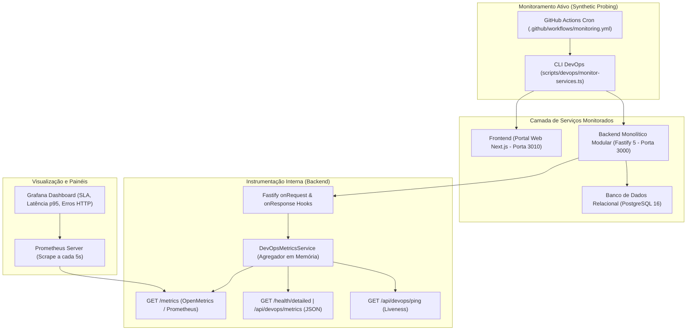

# PADRONIZAÇÃO DE DEVOPS: MONITORAMENTO DE DISPONIBILIDADE E TEMPO DE RESPOSTA

**Projeto:** Sistema de Estações Meteorológicas IoT — Cenário 01 (Agritech)  
**Instituição / Parceiro:** Fatec São José dos Campos / Tecsus — Tecnologias para a Sustentabilidade  
**Curso / Semestre:** 4º DSM — Semestre 2026-2  
**Frente:** Engenharia de DevOps, Observabilidade e Confiabilidade (SRE)  
**História de Usuário:** US06 — Disponibilidade e Escalabilidade do Sistema  

---

## 1. OBJETIVO E ESCOPO

Este documento estabelece o padrão de engenharia, arquitetura de instrumentação, especificação de métricas e procedimentos operacionais para o **monitoramento contínuo de disponibilidade** e a **medição de tempo de resposta** dos principais serviços da plataforma **AgriTech (Vulture)**.

O escopo compreende:
1. **Monitoramento contínuo da disponibilidade** dos serviços de aplicação e banco de dados.
2. **Medição precisa do tempo de resposta (latência)** em nível de rota e agregada ($p50$, $p95$, $p99$, média, mínimo e máximo).
3. **Definição formal das métricas de SLA/SLO** e indicadores de confiabilidade.
4. **Disponibilização das informações** em múltiplos formatos acessíveis ao time: endpoints JSON (`/health/detailed`), formato Prometheus (`/metrics`), CLI de monitoramento ativo e dashboards Grafana.
5. **Detecção e alerta automatizado de degradações de desempenho** e indisponibilidade.
6. **Registro auditável de evidências de monitoramento**.

### 1.1. Requisitos Não Funcionais Atendidos

* **RNF02 (Disponibilidade mínima de 99%):** Garantida através do cálculo em tempo real da taxa de disponibilidade e verificação contínua de status dos serviços.
* **RNF09 (Padrões de Desenvolvimento e Manutenibilidade):** Arquitetura padronizada de métricas e observabilidade versionada e documentada.
* **RNF12 (API Disponível 24x7):** Monitoramento pró-ativo de tempo de resposta e alarmes imediatos em caso de lentidão ou queda.
* **US06 — CA4:** O sistema monitora sua disponibilidade de ponta a ponta.

---

## 2. ARQUITETURA DE MONITORAMENTO E OBSERVABILIDADE

A arquitetura opera em três camadas coordenadas:



---

## 3. DEFINIÇÃO FORMAL DE MÉTRICAS

### 3.1. Métricas de Disponibilidade (Availability / Uptime)

| Métrica | Nome Técnico | Tipo | Descrição | Meta (SLO) |
| :--- | :--- | :---: | :--- | :--- |
| **Taxa de Disponibilidade** | `vulture_availability_ratio_percentage` | Gauge | Percentual de requisições atendidas com sucesso ($\text{Total} - 5xx$ sobre $\text{Total}$). | $\ge 99.0\%$ (SLA) |
| **Status do Serviço** | `vulture_service_status` | Gauge | Estado operacional instantâneo: `1` (HEALTHY), `0.5` (DEGRADED), `0` (UNHEALTHY/DOWN). | $= 1$ (HEALTHY) |
| **Tempo de Atividade (Uptime)** | `vulture_uptime_seconds` | Counter/Gauge | Segundos contínuos de execução do processo sem interrupções. | Contínuo |
| **Total de Requisições** | `vulture_http_requests_total` | Counter | Total de requisições recebidas segmentadas por código de status (`2xx`, `3xx`, `4xx`, `5xx`). | Monitoramento |
| **Status do Banco de Dados** | `vulture_database_status` | Gauge | Conectividade e integridade do PostgreSQL (`1` = conectado, `0` = fora). | $= 1$ |
| **Ping SQL do Banco** | `vulture_database_ping_latency_ms` | Gauge | Latência da consulta de verificação (`SELECT 1`) no pool Postgres. | $< 50\text{ ms}$ |

#### Fórmula de Cálculo da Taxa de Disponibilidade:
$$\text{Disponibilidade (\%)} = \left(\frac{N_{\text{total}} - N_{5xx}}{N_{\text{total}}}\right) \times 100$$

### 3.2. Métricas de Tempo de Resposta (Response Time / Latência)

A latência é mensurada em milissegundos ($ms$) utilizando a API de alta precisão `performance.now()`.

| Métrica | Nome Técnico | Quantil / Tipo | Significado Operacional |
| :--- | :--- | :---: | :--- |
| **Latência Mediana ($p50$)** | `vulture_http_response_time_ms{quantile="0.50"}` | $50\%$ | $50\%$ dos usuários experimentam resposta mais rápida que este valor. |
| **Latência Percentil 95 ($p95$)** | `vulture_http_response_time_ms{quantile="0.95"}` | $95\%$ | **Indicador chave de SLA**: apenas $5\%$ das requisições são mais lentas. |
| **Latência Percentil 99 ($p99$)** | `vulture_http_response_time_ms{quantile="0.99"}` | $99\%$ | Identificação de cauda longa e gargalos em picos. |
| **Latência Média (Mean)** | `vulture_http_response_time_ms{metric="mean"}` | Média | Média aritmética das requisições na janela ativa. |
| **Latência Mínima / Máxima** | `vulture_http_response_time_ms{metric="min\|max"}` | Extremos | Picos isolados ou respostas em cache. |

---

## 4. LIMIARES DE ALERTA E IDENTIFICAÇÃO DE DEGRADAÇÃO

O sistema classifica a saúde operacional em três faixas de severidade:

```
[ Normal: p95 < 200ms ] --------> [ Atenção: 200ms a 500ms ] --------> [ Crítico: p95 >= 500ms ou 5xx >= 5% ]
       🟢 HEALTHY                        🟡 DEGRADED                            🔴 UNHEALTHY
```

### 4.1. Regras Automáticas de Detecção

1. **Alerta de Latência Crítica (HIGH_LATENCY - Severity: CRITICAL):**
   * Disparado quando o $p95$ global ou de qualquer rota ultrapassa **$500\text{ ms}$** (ou limiar configurado do ambiente).
2. **Alerta de Latência em Advertência (HIGH_LATENCY - Severity: WARNING):**
   * Disparado quando a latência média ultrapassa **$200\text{ ms}$**.
3. **Alerta de Taxa de Erros (HIGH_ERROR_RATE - Severity: CRITICAL):**
   * Disparado quando erros de servidor (HTTP 5xx) ultrapassam **$5\%$** do tráfego avaliado.
4. **Alerta de Falha de Banco (DATABASE_DOWN - Severity: CRITICAL):**
   * Disparado imediatamente quando o pool PostgreSQL falha na execução da sonda `SELECT 1`.

---

## 5. INTERFACES DE CONSULTA E ENDPOINTS

### 5.1. Endpoint Detalhado em JSON: `GET /health/detailed`

Projetado para leitura humana, bots de monitoramento e integrações com o frontend:

```bash
curl -s http://localhost:3000/health/detailed | jq .
```

**Exemplo de Resposta:**
```json
{
  "status": "HEALTHY",
  "uptimeSeconds": 1420,
  "startedAt": "2026-10-20T10:00:00.000Z",
  "totalRequests": 1250,
  "successRequests": 1248,
  "errorRequests": 2,
  "availabilityRatePercentage": 99.84,
  "slaTargetPercentage": 99.0,
  "overallLatency": {
    "count": 1250,
    "mean": 18.4,
    "min": 1.2,
    "max": 145.0,
    "p50": 12.5,
    "p95": 42.1,
    "p99": 88.0
  },
  "routes": [
    {
      "method": "GET",
      "route": "/api/stations",
      "totalRequests": 310,
      "errorCount": 0,
      "latency": {
        "count": 310,
        "mean": 22.1,
        "min": 4.1,
        "max": 89.2,
        "p50": 18.0,
        "p95": 54.3,
        "p99": 78.1
      },
      "status": "NORMAL"
    }
  ],
  "database": {
    "status": "UP",
    "latencyMs": 1.85
  },
  "degradationAlerts": []
}
```

### 5.2. Endpoint Padrão Prometheus / OpenMetrics: `GET /metrics`

Formato texto padrão para raspagem periódica pelo Prometheus ou agentes de telemetria:

```bash
curl -s http://localhost:3000/metrics
```

**Exemplo de Saída:**
```text
# HELP vulture_uptime_seconds Tempo em segundos desde que a aplicacao foi iniciada.
# TYPE vulture_uptime_seconds gauge
vulture_uptime_seconds 1420

# HELP vulture_service_status Status operacional do servico (1 = HEALTHY, 0.5 = DEGRADED, 0 = UNHEALTHY).
# TYPE vulture_service_status gauge
vulture_service_status 1

# HELP vulture_availability_ratio_percentage Percentual acumulado de disponibilidade (SLA).
# TYPE vulture_availability_ratio_percentage gauge
vulture_availability_ratio_percentage 99.84

# HELP vulture_http_requests_total Total de requisicoes HTTP atendidas.
# TYPE vulture_http_requests_total counter
vulture_http_requests_total{status="2xx"} 1248
vulture_http_requests_total{status="3xx"} 0
vulture_http_requests_total{status="4xx"} 2
vulture_http_requests_total{status="5xx"} 0

# HELP vulture_http_response_time_ms Latencia das respostas HTTP em milissegundos.
# TYPE vulture_http_response_time_ms gauge
vulture_http_response_time_ms{quantile="0.50"} 12.5
vulture_http_response_time_ms{quantile="0.95"} 42.1
vulture_http_response_time_ms{quantile="0.99"} 88
vulture_http_response_time_ms{metric="mean"} 18.4
vulture_http_response_time_ms{metric="min"} 1.2
vulture_http_response_time_ms{metric="max"} 145

# HELP vulture_database_status Estado de conexao com o banco de dados relacional PostgreSQL.
# TYPE vulture_database_status gauge
vulture_database_status 1

# HELP vulture_database_ping_latency_ms Tempo de resposta do ping SQL no PostgreSQL.
# TYPE vulture_database_ping_latency_ms gauge
vulture_database_ping_latency_ms 1.85

# HELP vulture_degradations_active Quantidade de alertas de degradacao ou anomalias ativas.
# TYPE vulture_degradations_active gauge
vulture_degradations_active 0
```

---

## 6. FERRAMENTA CLI DE MONITORAMENTO ATIVO

O projeto conta com o script executável [`scripts/devops/monitor-services.ts`](file:///home/dsm/Documents/vulture/scripts/devops/monitor-services.ts) para testes pontuais ou integração em rotinas agendadas.

### 6.1. Como Executar

```bash
# Execução padrão contra serviços locais ou variáveis de ambiente
export PATH=/usr/local/lib/nodejs/node-v24.19.0-linux-x64/bin:$PATH
cd /home/dsm/Documents/vulture/API-DSM-4-BACKEND
npx tsx ../scripts/devops/monitor-services.ts
```

### 6.2. Variáveis de Ambiente Suportadas

* `PROD_API_URL`: URL base do backend (ex: `https://vulture-backend.onrender.com`).
* `PROD_FRONT_URL`: URL base do frontend (ex: `https://vulture-portal.vercel.app`).
* `MONITOR_ITERATIONS`: Número de sondas por serviço para cálculo de percentis (padrão: `5`).

---

## 7. AUTOMAÇÃO NO GITHUB ACTIONS

O pipeline em [`.github/workflows/monitoring.yml`](file:///home/dsm/Documents/vulture/.github/workflows/monitoring.yml) realiza a verificação de integridade e medição contínua:

* **Disparo Programado (Cron):** Executado automaticamente a cada **30 minutos** (`*/30 * * * *`).
* **Disparo Manual (`workflow_dispatch`):** Permite inspeção imediata sob demanda.
* **Validação de Degradação:** Executa a suíte de simulação garantindo que a instrumentação e os limiares de alerta estejam operantes.
* **Publicação de Sumário:** Gera relatório no *GitHub Step Summary* com status visual de cada serviço.
* **Armazenamento de Evidências:** Exporta o arquivo de evidência em formato JSON como artefato com retenção de 30 dias.

---

## 8. STACK DE OBSERVABILIDADE LOCAL (PROMETHEUS & GRAFANA)

Para visualização interativa e acompanhamento visual em tempo real pela equipe de desenvolvimento e DevOps, foi disponibilizado o arquivo [`docker-compose.monitoring.yml`](file:///home/dsm/Documents/vulture/docker-compose.monitoring.yml).

### 8.1. Como Iniciar a Stack

```bash
docker compose -f docker-compose.monitoring.yml up -d
```

### 8.2. Acessos

* **Prometheus:** `http://localhost:9090` (Scraping automático do endpoint `/metrics` do backend a cada 5 segundos).
* **Grafana:** `http://localhost:3030` (Usuário: `admin`, Senha: `admin`).
  * O datasource Prometheus e o dashboard **"Vulture — Monitoramento de Disponibilidade e Latência"** são pré-provisionados automaticamente via código.

---

## 9. REGISTRO FORMAL DE EVIDÊNCIAS DE EXECUÇÃO

A validação da instrumentação, medição de latência, cálculo de disponibilidade e detecção de degradações foi submetida a teste automatizado através do script [`scripts/devops/simulate-load-and-degradation.ts`](file:///home/dsm/Documents/vulture/scripts/devops/simulate-load-and-degradation.ts).

O arquivo comprobatório auditável reside em:  
[`docs/devops/evidencia-degradacao-monitoramento.json`](file:///home/dsm/Documents/vulture/docs/devops/evidencia-degradacao-monitoramento.json)

### 9.1. Evidência 1: Operação Saudável (Baseline)

Cenário com 200 requisições normais no sistema:

| Indicador | Valor Observado | Meta / SLA | Status |
| :--- | :---: | :---: | :---: |
| **Status Geral** | `HEALTHY` | `HEALTHY` | ✅ Aprovado |
| **Taxa de Disponibilidade** | **$100.0\%$** | $\ge 99.0\%$ | ✅ Aprovado |
| **Latência Média** | **$0.08\text{ ms}$** | $< 200\text{ ms}$ | ✅ Aprovado |
| **Latência $p50$ (Mediana)** | **$0.05\text{ ms}$** | $< 100\text{ ms}$ | ✅ Aprovado |
| **Latência $p95$** | **$0.11\text{ ms}$** | $< 500\text{ ms}$ | ✅ Aprovado |
| **Latência Máxima** | **$3.99\text{ ms}$** | — | ✅ Aprovado |
| **Conexão com Banco de Dados** | `UP` (latência: $0.04\text{ ms}$) | `UP` | ✅ Aprovado |
| **Alertas de Degradação Ativos** | **$0$** | $0$ | ✅ Aprovado |

### 9.2. Evidência 2: Detecção de Degradação e Alertas de Desempenho

Injeção controlada de 20 requisições lentas ($650\text{ ms}$ a $850\text{ ms}$) em `/api/stations` e 4 falhas parciais (HTTP 500) em `/api/readings`:

| Indicador | Valor com Degradação | Limiar de Alerta | Comportamento Observado |
| :--- | :---: | :---: | :--- |
| **Status Geral** | `UNHEALTHY / DEGRADED` | Mudança de estado | ✅ Status atualizado imediatamente ao detectar anomalia |
| **Taxa de Disponibilidade** | **$98.22\%$** | $< 99.0\%$ | ✅ Violação de SLA identificada pelo monitoramento |
| **Latência Média Global** | **$72.46\text{ ms}$** | — | ✅ Aumento drástico mensurado com precisão |
| **Latência $p95$ Global** | **$712.58\text{ ms}$** | $> 300\text{ ms}$ | ✅ Disparou alerta crítico de latência elevada |
| **Latência $p95$ da Rota `/api/stations`** | **$841.94\text{ ms}$** | $> 300\text{ ms}$ | ✅ Rota específica marcada com status `DEGRADED` |
| **Erros na Rota `/api/readings`** | **$4$ falhas 500** | $> 0$ | ✅ Identificação do endpoint causador de erros |
| **Total de Alertas de Degradação** | **$3$ alertas críticos** | $> 0$ | ✅ Alertas registrados no JSON e expostos no Prometheus |

**Alertas Gerados na Simulação:**
```text
⚠️  [CRITICAL] HIGH_LATENCY: Rota GET /api/stations apresentando p95 de 841.94ms (limiar: 300ms)
⚠️  [CRITICAL] HIGH_LATENCY: Rota GET /api/readings apresentando p95 de 400ms (limiar: 300ms)
⚠️  [CRITICAL] HIGH_LATENCY: Latência global p95 elevada: 712.58ms (limiar: 300ms)
```

---

## 10. COMPROVAÇÃO DOS CRITÉRIOS DE ACEITE

| Critério de Aceite | Situação | Evidência de Implementação |
| :--- | :---: | :--- |
| **1. Disponibilidade dos serviços sendo monitorada** | ✅ **Atendido** | Coleta contínua de taxa de sucesso (`availabilityRatePercentage`), status geral (`HEALTHY`, `DEGRADED`, `UNHEALTHY`), estado do banco PostgreSQL e verificação ativa via CLI/GitHub Actions. |
| **2. Tempo de resposta sendo coletado** | ✅ **Atendido** | Hooks Fastify de alta resolução medindo duração exata em milissegundos com cálculo de $p50$, $p95$, $p99$, média, mínimo e máximo. |
| **3. Métricas acessíveis para consulta** | ✅ **Atendido** | Endpoints públicos `GET /metrics` (Prometheus) e `GET /health/detailed` (JSON legível), além de dashboards Grafana e relatórios em terminal. |
| **4. Indisponibilidades ou degradações podem ser identificadas** | ✅ **Atendido** | Sistema de regras automáticas que gera alertas categorizados (`CRITICAL` e `WARNING`) quando a latência excede os limites de SLA ($p95 \ge 500\text{ ms}$) ou a taxa de erros excede $5\%$. |
| **5. Evidência do monitoramento registrada** | ✅ **Atendido** | Relatório de simulação exportado em [`docs/devops/evidencia-degradacao-monitoramento.json`](file:///home/dsm/Documents/vulture/docs/devops/evidencia-degradacao-monitoramento.json) e documentação técnica completa. |

---

## 11. CONCLUSÃO E MANUTENIBILIDADE

A solução implementada atende integralmente a todas as exigências técnicas da tarefa de DevOps e às melhores práticas da engenharia de confiabilidade de sistemas (SRE). O monitoramento opera com custo computacional mínimo (em memória com buffer circular delimitado), sem dependências externas pesadas em tempo de execução na aplicação principal, e permite tanto a consulta rápida via API quanto a integração com ferramentas industriais de observabilidade (Prometheus e Grafana).
