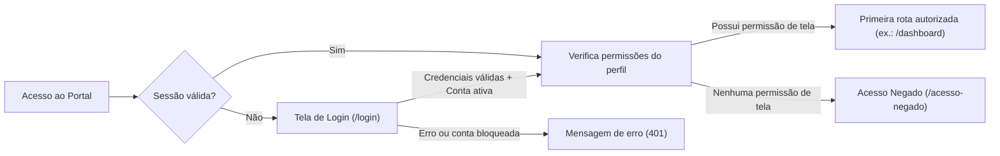
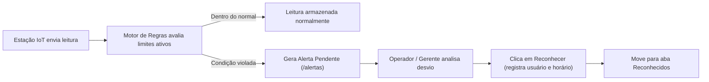

# MANUAL DO USUÁRIO — PORTAL AGROCLIMA 360

**Projeto:** Sistema de Estações Meteorológicas IoT — Cenário 01 (Agritech / Equipe Vulture)  
**Instituição / Parceiro:** Fatec São José dos Campos / Tecsus — Tecnologias para a Sustentabilidade  
**Curso / Semestre:** 4º DSM — Semestre 2026-2  
**Frente:** Documentação de Produto e Operação  
**Versão:** 1.0  
**Última atualização:** 21/11/2026  

---

## Sumário

1. [Objetivo e Visão Geral](#1-objetivo-e-visão-geral)
2. [Requisitos de Acesso e Navegação](#2-requisitos-de-acesso-e-navegação)
3. [Perfis de Acesso e Permissões](#3-perfis-de-acesso-e-permissões)
4. [Módulo de Monitoramento](#4-módulo-de-monitoramento)
   - [4.1. Dashboard em Tempo Real (`/dashboard`)](#41-dashboard-em-tempo-real-dashboard)
   - [4.2. Estatísticas e Previsões (`/dashboard/stats`)](#42-estatísticas-e-previsões-dashboardstats)
   - [4.3. Propriedades Agrícolas (`/propriedades`)](#43-propriedades-agrícolas-propriedades)
   - [4.4. Estações Meteorológicas e Sensores (`/estacoes` e `/estacoes/[id]`)](#44-estações-meteorológicas-e-sensores-estacoes-e-estacoesid)
   - [4.5. Histórico Meteorológico (`/historico`)](#45-histórico-meteorológico-historico)
   - [4.6. Relatórios Consolidados (`/relatorios`)](#46-relatórios-consolidados-relatorios)
5. [Módulo de Alertas](#5-módulo-de-alertas)
   - [5.1. Alertas Disparados (`/alertas`)](#51-alertas-disparados-alertas)
   - [5.2. Regras de Alerta (`/alertas/regras`)](#52-regras-de-alerta-alertasregras)
6. [Módulo de Administração](#6-módulo-de-administração)
   - [6.1. Usuários (`/administracao/usuarios`)](#61-usuários-administracaousuarios)
   - [6.2. Parâmetros Meteorológicos (`/administracao/parametros`)](#62-parâmetros-meteorológicos-administracaoparametros)
   - [6.3. Perfis e Permissões (`/administracao/perfis`)](#63-perfis-e-permissões-administracaoperfis)
7. [Solução de Problemas e Perguntas Frequentes (FAQ)](#7-solução-de-problemas-e-perguntas-frequentes-faq)
8. [Glossário e Referências](#8-glossário-e-referências)

---

## 1. Objetivo e Visão Geral

Este manual orienta a operação cotidiana do portal web **AgroClima 360**, desenvolvido pela **Equipe Vulture** para o monitoramento meteorológico de áreas agrícolas por meio de estações IoT.

A plataforma centraliza a recepção, validação, armazenamento e visualização de dados climáticos coletados em campo (como temperatura, umidade do ar, umidade do solo, precipitação, vento e pressão atmosférica), permitindo que **Administradores**, **Gerentes Agrícolas** e **Operadores** acompanhem a saúde da rede de sensores, identifiquem anomalias e atuem rapidamente diante de condições climáticas críticas.

### 1.1. Requisitos Atendidos por Este Manual

| Referência | Escopo Coberto |
| :--- | :--- |
| **RF01 – RF03** | Cadastro e gerenciamento de estações meteorológicas, sensores vinculados e parâmetros de medição. |
| **RF07 – RF11** | Monitoramento operacional (`Online`, `Com alerta`, `Offline`), alertas disparados e consulta/resolução de ocorrências. |
| **RNF07 (Usabilidade)** | Fluxos claros de navegação, formulários com validação em tempo real, feedbacks visuais e prevenção de erros. |

---

## 2. Requisitos de Acesso e Navegação

### 2.1. Pré-requisitos do Usuário

* **Navegador atualizado:** Google Chrome, Mozilla Firefox, Microsoft Edge ou Safari (versões recentes com suporte a JavaScript e WebSocket).
* **Conexão com a internet ou rede corporativa:** necessária para carregar o portal e receber atualizações em tempo real das estações.
* **Credenciais válidas:** e-mail e senha cadastrados por um Administrador, com conta em status **Ativo** e perfil associado às permissões da sua função.

### 2.2. Como Acessar o Sistema (`/login`)

1. Abra o endereço do portal no navegador; caso não esteja autenticado, você será redirecionado automaticamente para `/login`.
2. Informe seu **E-mail** e sua **Senha** (é possível alternar a visualização da senha pelo ícone de olho no campo).
3. Clique em **Entrar**.
4. Após a autenticação, o sistema redireciona você automaticamente para a primeira tela autorizada pelo seu perfil (por padrão, o **Dashboard**).

> [!NOTE]
> **Validade da sessão e segurança:**
> * O token de autenticação (JWT) tem validade padrão de **1 hora**. Ao expirar, o portal encerra a sessão automaticamente e solicita novo login.
> * Por segurança, há limitação de tentativas na rota de login (padrão de **10 tentativas por minuto** por endereço IP). Caso ultrapasse esse limite, aguarde o período indicado antes de tentar novamente.
> * Não há redefinição automática de senha pela tela de login; em caso de esquecimento ou bloqueio, contate um **Administrador**.

### 2.3. Estrutura da Navegação

O menu principal organiza as funcionalidades em **três grupos** e exibe automaticamente apenas os itens compatíveis com as permissões do usuário autenticado:

| Grupo | Item de Menu | Rota | Finalidade |
| :--- | :--- | :--- | :--- |
| **Monitoramento** | Dashboard | `/dashboard` | Status da rede, leituras atuais, mapa, alertas e ocorrências |
| **Monitoramento** | Estatísticas | `/dashboard/stats` | Extremos por estação, limites operacionais e previsão de 7 dias |
| **Monitoramento** | Propriedades | `/propriedades` | Cadastro de fazendas/áreas e vínculo com estações |
| **Monitoramento** | Estações | `/estacoes` | Gestão de estações, sensores, calibração e intervalo de coleta |
| **Monitoramento** | Histórico | `/historico` | Consulta de leituras históricas com agregação e exportação CSV |
| **Monitoramento** | Relatórios | `/relatorios` | Geração e exportação (CSV/JSON) de relatórios consolidados |
| **Alertas** | Alertas disparados | `/alertas` | Acompanhamento e reconhecimento de alertas gerados |
| **Alertas** | Regras de alerta | `/alertas/regras` | Criação e gestão dos limites que disparam avisos |
| **Administração** | Usuários | `/administracao/usuarios` | Cadastro, edição e bloqueio/desbloqueio de contas |
| **Administração** | Parâmetros | `/administracao/parametros` | Catálogo de tipos de medição, unidades, calibração e limites físicos |
| **Administração** | Perfis e permissões | `/administracao/perfis` | Gestão de cargos/perfis e concessão granular de permissões |

Para encerrar sua sessão com segurança, utilize a opção **Sair** disponível no menu do usuário no topo da interface.

---

## 3. Perfis de Acesso e Permissões

O AgroClima 360 utiliza controle de acesso baseado em perfis (**RBAC**). Cada usuário possui um perfil (cargo) que agrupa permissões no formato `recurso.ação` (por exemplo, `stations.read`, `stations.create`, `triggered-alerts.acknowledge`).

> [!IMPORTANT]
> **Regras de autorização:**
> * Na instalação inicial, o perfil **Administrador** recebe todas as permissões do catálogo. Novos perfis criados posteriormente começam sem permissões até que sejam configurados em **Administração → Perfis e permissões**.
> * Alterações de permissões, mudança de perfil ou bloqueio de usuário passam a valer **imediatamente** na requisição seguinte, sem precisar aguardar a expiração do token.
> * Caso você tente acessar diretamente uma URL sem a permissão exigida, o portal exibirá a tela **Acesso Negado** (`/acesso-negado`).

### 3.1. Permissões Exigidas por Tela

| Tela / Rota | Permissão mínima de acesso | Principais permissões de ação |
| :--- | :--- | :--- |
| `/dashboard`, `/dashboard/stats`, `/historico`, `/relatorios` | `monitoring.read` | `occurrences.read`, `occurrences.resolve` (painel de ocorrências) |
| `/propriedades` | `properties.read` | `properties.create`, `properties.update`, `properties.delete` |
| `/estacoes` e `/estacoes/[id]` | `stations.read` | `stations.create`, `stations.update`, `stations.delete`, `sensors.*`, `station-collection.read`, `station-collection.update` |
| `/alertas` | `triggered-alerts.read` | `triggered-alerts.acknowledge` |
| `/alertas/regras` | `alert-configs.read` | `alert-configs.create`, `alert-configs.update`, `alert-configs.delete` |
| `/administracao/usuarios` | `users.read` | `users.create`, `users.update`, `users.delete` |
| `/administracao/parametros` | `sensor-types.update` | `sensor-types.create`, `sensor-types.update`, `sensor-types.delete` |
| `/administracao/perfis` | `roles.read` | `roles.create`, `roles.update`, `roles.delete`, `roles.permissions.update`, `permissions.read` |

---

## 4. Módulo de Monitoramento

### 4.1. Dashboard em Tempo Real (`/dashboard`)

O **Dashboard** é a tela inicial de acompanhamento operacional das áreas monitoradas.

**Principais elementos da tela:**

1. **Resumo da Rede:** cards no topo com a contagem consolidada de estações em cada estado:
   * **Online:** estação enviando telemetria dentro do intervalo esperado.
   * **Com alerta:** estação operando, porém com alerta ativo ou condição fora do limite configurado.
   * **Offline:** estação sem comunicação recente dentro da janela tolerada.
2. **Filtros de Contexto:** permite filtrar os dados por **Propriedade** e por **Estação**. Ao escolher uma propriedade sem estações vinculadas, a seleção de estações é sincronizada automaticamente.
3. **Condições Climáticas Atuais:** exibe as leituras mais recentes dos sensores (temperatura, umidade, vento, pressão, umidade do solo, precipitação etc.), com atualização automática periódica (a cada 30 segundos e via WebSocket quando disponível) e indicador do horário da última leitura.
4. **Mapa Georreferenciado:** apresenta a localização das estações com coordenadas cadastradas e seu status operacional.
5. **Alertas Pendentes:** card com resumo dos alertas ainda não reconhecidos e atalho para a tela de alertas.
6. **Painel de Ocorrências Abertas** *(visível para perfis com `occurrences.read`)*: lista falhas operacionais ou inconsistências detectadas nas estações/sensores em status **Aberta (`OPEN`)**.
   * Clique sobre uma ocorrência para visualizar detalhes (estação, descrição, data/hora de detecção).
   * Caso possua permissão `occurrences.resolve`, clique em **Resolver ocorrência** para encerrá-la após a verificação ou manutenção.

---

### 4.2. Estatísticas e Previsões (`/dashboard/stats`)

A tela de **Estatísticas** apoia a análise de tendências climáticas e o planejamento agrícola.

**O que é possível fazer:**

* **Comparar extremos por estação:** visualizar gráficos com valores mínimos, médios e máximos registrados no período selecionado.
* **Acompanhar limites operacionais:** comparar o comportamento das medições frente aos limiares definidos nas regras de alerta.
* **Consultar previsão de 7 dias:** verificar a tendência diária (temperaturas máxima e mínima, probabilidade e volume de chuva, rajadas de vento e condição climática) no calendário de previsão.
* **Exportar CSV:** baixar os dados estatísticos do período exibido.

> [!TIP]
> Se os filtros aplicados não retornarem registros no período escolhido, o botão de exportação para CSV fica desabilitado automaticamente para evitar o download de arquivos vazios.

---

### 4.3. Propriedades Agrícolas (`/propriedades`)

Permite organizar fazendas, talhões ou áreas produtivas e vinculá-las às estações meteorológicas.

**Filtros disponíveis:**
* Busca por texto, filtro por **Município/UF**, **Responsável**, **Estação associada** e opção para exibir apenas propriedades com telemetria ativa.

**Como cadastrar ou editar uma propriedade:**
1. Clique em **Nova propriedade** (ou no ícone de edição na linha da propriedade desejada).
2. Preencha os campos do formulário:
   * **Nome** *(obrigatório, mínimo de 3 caracteres)*;
   * **Localização** *(opcional, ex.: município/UF ou referência geográfica)*;
   * **Responsável** *(obrigatório — selecione um usuário cadastrado no sistema)*.
3. Clique em **Salvar**.

**Vínculo de estações e exclusão:**
* Utilize o modal de **Estações vinculadas** para consultar ou gerenciar quais estações pertencem à propriedade.
* A exclusão solicita confirmação prévia em caixa de diálogo para evitar remoções acidentais.

---

### 4.4. Estações Meteorológicas e Sensores (`/estacoes` e `/estacoes/[id]`)

Centraliza o inventário técnico de estações IoT, o acompanhamento da comunicação e a configuração de sensores.

#### Listagem de Estações (`/estacoes`)

* Exibe cada estação com **Status** (`Online`, `Com alerta`, `Offline`), propriedade associada, endereço MAC do datalogger, horário da última comunicação e **atraso de telemetria**.
* Permite filtrar por **Propriedade**, **Status** e **busca textual**. Caso nenhum resultado seja encontrado, use o botão **Limpar filtros** exibido no estado vazio.

#### Como cadastrar ou editar uma estação

1. Clique em **Nova estação** (ou no botão de edição da estação).
2. Preencha os campos:
   * **Propriedade** *(obrigatório)*;
   * **Nome da estação** *(obrigatório, mínimo de 3 caracteres)*;
   * **Endereço MAC** *(obrigatório, no formato `AA:BB:CC:DD:EE:FF` ou `AA-BB-CC-DD-EE-FF`)*;
   * **Latitude** *(opcional, entre `-90` e `90`)*;
   * **Longitude** *(opcional, entre `-180` e `180`)*.
3. Clique em **Salvar**.

#### Detalhes da Estação (`/estacoes/[id]`)

Ao clicar em uma estação na listagem, você acessa sua visão completa:

1. **Leituras atuais e série temporal:** valores em tempo real de cada sensor e gráfico de tendência recente.
2. **Mapa individual:** posicionamento geográfico da estação (quando latitude e longitude estiverem preenchidas).
3. **Sensores da estação:**
   * Clique em **Adicionar sensor** (ou edite/exclua um sensor existente) para vincular um **Tipo de medição (Parâmetro)**, selecionar o **canal da placa** e, se necessário, configurar **calibração específica** (multiplicador/ganho e offset).
4. **Configuração da coleta** *(visível para perfis com `station-collection.read` / `station-collection.update`)*:
   * Exibe o **MAC do datalogger**, o **intervalo de coleta atual** e o estado de comunicação.
   * Permite ajustar o intervalo de envio da estação (em segundos/minutos conforme a faixa permitida) e salvar a nova configuração.

---

### 4.5. Histórico Meteorológico (`/historico`)

Permite auditar e analisar medições armazenadas em períodos anteriores.

**Como consultar:**
1. Selecione os filtros desejados: **Propriedade**, **Estação** e **Sensor/Parâmetro**.
2. Escolha a janela temporal: **Últimas 24h**, **7 dias**, **30 dias** ou **Personalizado** (definindo data inicial e final).
3. Defina o **Agrupamento** (`10 min`, `30 min`, `1h` ou `1d`) e o tipo de **Agregação** (`Média`, `Mínima`, `Máxima` ou `Bruto`).
4. Navegue pelos resultados paginados na tabela — leituras associadas a violações de limite exibem indicadores de severidade.
5. Para baixar a consulta atual, clique em **Exportar CSV** (disponível sempre que houver ao menos um registro listado).

---

### 4.6. Relatórios Consolidados (`/relatorios`)

Permite gerar relatórios prontos para compartilhamento, auditoria e tomada de decisão.

#### Tipos de Relatório Disponíveis

| Tipo | Conteúdo Gerado | Filtros Principais |
| :--- | :--- | :--- |
| **Histórico de Leituras** | Consolida leituras brutas, médias, extremos (mín./máx.), desvio padrão e acumulados por tipo de sensor, além da indicação de consistência dos dados. | Propriedade, Estação (opcional), Data inicial e Data final |
| **Previsão Meteorológica** | Apresenta a tendência climática diária com temperaturas máxima/mínima, precipitação esperada, probabilidade de chuva e velocidade máxima do vento. | Propriedade, **Estação (obrigatória)** e quantidade de dias |
| **Alertas e Ocorrências** | Lista todos os alertas disparados no período com regra violada, valor lido, limite configurado, data/hora e situação (`Pendente` ou `Reconhecido`). | Propriedade, Estação (opcional), Data inicial e Data final |

#### Como gerar e exportar

1. Selecione o **Tipo de relatório** desejado nos cards superiores.
2. Ajuste os filtros (Propriedade, Estação, Período ou Dias) e visualize o resumo e a tabela gerados em tela.
3. Clique em **Exportar CSV** ou **Exportar JSON** para realizar o download do arquivo.
4. Para retornar aos filtros padrão, utilize o botão **Limpar / Redefinir**.

---

## 5. Módulo de Alertas

O motor de regras avalia continuamente as novas leituras recebidas das estações e dispara alertas sempre que uma condição configurada é violada.

### 5.1. Alertas Disparados (`/alertas`)

1. Utilize as abas segmentadas no topo da tabela para alternar entre:
   * **Pendentes:** alertas que ainda exigem ciência da equipe.
   * **Reconhecidos:** histórico de alertas já tratados, exibindo o operador responsável e a data/hora do reconhecimento.
2. Cada linha apresenta a estação, o sensor, a regra violada, o valor registrado e o **desvio em relação ao limite** (por exemplo, `+2,5 °C do limite`).
3. Para dar ciência a um alerta pendente *(exige `triggered-alerts.acknowledge`)*:
   * Clique em **Reconhecer** na linha correspondente.
   * O sistema registra automaticamente o seu usuário autenticado como responsável e move o item para a aba **Reconhecidos**.

### 5.2. Regras de Alerta (`/alertas/regras`)

Define quais condições climáticas devem gerar avisos automáticos.

**Como criar ou editar uma regra:**
1. Clique em **Nova regra** (ou edite uma regra existente).
2. Preencha os campos do formulário:
   * **Estação** e **Sensor** *(obrigatórios — a lista de sensores é filtrada conforme a estação escolhida)*;
   * **Operador de comparação:** `>` (maior que), `<` (menor que), `>=` (maior ou igual a), `<=` (menor ou igual a), `=` (igual a) ou `!=` (diferente de);
   * **Valor de referência** *(obrigatório, número na unidade de medida do sensor)*;
   * **Mensagem personalizada** *(opcional, até 200 caracteres)*;
   * **Responsável (Gerente)** *(opcional)*;
   * **Status da regra:** **Ativa** ou **Inativa** (switch).
3. Clique em **Criar regra** ou **Salvar**.

> [!TIP]
> Regras marcadas como **Inativas** permanecem cadastradas para reutilização futura, mas são ignoradas pelo motor de regras até serem reativadas.

---

## 6. Módulo de Administração

### 6.1. Usuários (`/administracao/usuarios`)

Permite gerenciar todas as contas de acesso ao portal.

* **Busca e filtros:** localize usuários por nome/e-mail, filtre por **Status** (Ativo/Bloqueado) ou por **Cargo/Perfil**. Use **Limpar filtros** se a busca retornar vazia.
* **Cadastrar usuário:** clique em **Novo usuário** e informe:
  * **Nome** *(obrigatório)*;
  * **E-mail** *(obrigatório, formato válido e único no sistema)*;
  * **Senha** *(obrigatório no cadastro, mínimo de 8 caracteres)*;
  * **Cargo / Perfil** *(obrigatório)*;
  * **Conta ativa** *(switch — habilitada por padrão)*.
* **Editar usuário:** permite alterar **Nome**, **Cargo/Perfil** e status **Ativo**.
* **Bloqueio e desbloqueio rápido:** utilize o switch de acesso na listagem para bloquear ou desbloquear um usuário imediatamente.

> [!WARNING]
> **Efeitos do bloqueio de usuário:**
> * Ao desativar um usuário, novos logins são rejeitados (`401`), qualquer token JWT já emitido deixa de funcionar na próxima requisição e conexões em tempo real (WebSocket) são encerradas imediatamente.
> * Um usuário bloqueado não consegue desbloquear a própria conta; a reativação deve ser feita por outro usuário ativo com permissão `users.update`.

---

### 6.2. Parâmetros Meteorológicos (`/administracao/parametros`)

Gerencia o catálogo de tipos de medição que podem ser atribuídos aos sensores das estações.

* **Visualização em cards:** cada parâmetro exibe ícone e cor identificadores, **Nome**, **Unidade de medida** (ex.: `°C`, `%`, `mm`, `hPa`, `km/h`), **calibração padrão** (multiplicador/offset), **limites físicos** e a quantidade de sensores atualmente vinculados.
* **Busca rápida:** filtre por nome do parâmetro ou pela unidade de medida.
* **Cadastro e edição:** clique em **Novo parâmetro** (ou no botão de edição do card) para definir nome, unidade, calibração e limites físicos aceitos na validação dos dados.
* **Exclusão protegida:** ao tentar excluir um parâmetro que ainda está em uso por algum sensor, o sistema impede a operação (erro `409`) e orienta a remoção prévia dos sensores vinculados.

---

### 6.3. Perfis e Permissões (`/administracao/perfis`)

Controla os cargos do sistema e exatamente o que cada perfil pode visualizar ou modificar.

1. **Criar ou editar perfil:** informe um **Nome** único *(1 a 50 caracteres)* e uma **Descrição** *(opcional, até 255 caracteres)*.
2. **Configurar permissões:**
   * Selecione o perfil desejado para visualizar a lista de permissões agrupadas por domínio funcional.
   * Marque ou desmarque permissões individualmente ou utilize o atalho **Marcar todas do grupo**.
   * Enquanto houver alterações pendentes, um **banner âmbar de aviso** indicará que existem modificações não salvas.
   * Clique em **Salvar permissões** para persistir as alterações (ou descarte-as para voltar ao estado anterior).
3. **Excluir perfil:** só é possível excluir um perfil que não possua nenhum usuário vinculado (ativo ou inativo). Caso haja vínculos, reatribua os usuários a outro perfil antes de tentar excluir.

---

## 7. Solução de Problemas e Perguntas Frequentes (FAQ)

| Situação / Mensagem | Causa Provável | Como Resolver |
| :--- | :--- | :--- |
| **Erro ao entrar (`401`) com senha correta** | E-mail digitado incorretamente, senha expirada/alterada ou conta **bloqueada** (`active = false`). | Confira o e-mail e solicite ao Administrador que verifique se a conta está ativa em **Administração → Usuários**. |
| **Tela "Acesso Negado" (`/acesso-negado`)** | Seu perfil não possui a permissão necessária para a rota acessada. | Solicite ao Administrador a revisão das concessões do seu perfil em **Administração → Perfis e permissões**. |
| **Erro `429` (Muitas requisições)** | Limite temporário de requisições por IP atingido (10/min no login ou 300/min nas demais rotas). | Aguarde cerca de 1 minuto antes de repetir a operação. |
| **Estação aparece como `Offline`** | Falha de energia, internet/MQTT ou datalogger sem enviar pacotes dentro do intervalo configurado. | Verifique a última comunicação em **Estações → Detalhes da estação**, confira o painel de **Ocorrências** no Dashboard e acione a manutenção em campo. |
| **Botão "Exportar CSV" desabilitado** | Os filtros aplicados não retornaram registros no período selecionado. | Amplie o período de datas ou limpe os filtros de propriedade/estação e tente novamente. |
| **Erro `409` ao excluir Parâmetro ou Perfil** | O registro possui dependências ativas (sensores vinculados ao parâmetro ou usuários vinculados ao perfil). | Remova ou reatribua os vínculos existentes antes de repetir a exclusão. |
| **Sessão encerrada inesperadamente** | Expiração natural do token (1 hora) ou alteração/bloqueio recente da conta. | Faça login novamente em `/login`. |

---

## 8. Glossário e Referências

### 8.1. Glossário

* **Datalogger:** dispositivo embarcado na estação meteorológica responsável por ler os sensores e transmitir os dados via MQTT.
* **MAC Address:** identificador físico único da placa/datalogger (ex.: `AA:BB:CC:DD:EE:FF`).
* **Motor de Regras:** componente do backend que avalia automaticamente cada leitura recebida frente às regras de alerta ativas.
* **Ocorrência:** registro operacional de falha de comunicação, inatividade ou inconsistência detectada em uma estação ou sensor.
* **RBAC (Role-Based Access Control):** modelo de autorização em que permissões são atribuídas a perfis (cargos), e os usuários herdam as permissões do perfil ao qual pertencem.
* **Telemetria:** conjunto de medições enviadas periodicamente pelas estações meteorológicas ao sistema.

### 8.2. Documentação Relacionada

* [README Principal do Projeto](../README.md)
* [Requisitos Funcionais](requisitos/requisitos-funcionais.md)
* [Requisitos Não Funcionais](requisitos/requisitos-nao-funcionais.md)
* [Regras de Gerenciamento de Estações Meteorológicas](regras-estacoes-meteorologicas.md)
* [Backlog do Produto](backlog/backlog-produto.md)
* [Padronização de Deploy Automático](devops/padronizacao_deploy_automatico.md)
